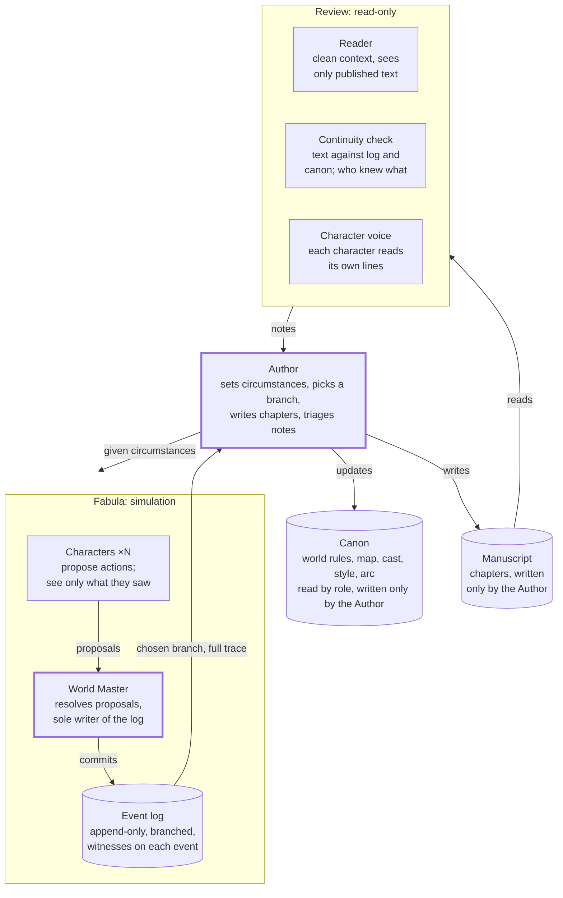
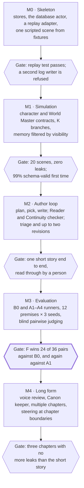

# Fabula Engine — Technical Specification v0.1

Oct 31, 2026 · @Vladimir Shylov

## 1. Summary

Fabula is a multi-agent story engine in which simulated characters produce what happens (the fabula) and one Author agent alone writes the text (the syuzhet). It combines the character and world simulation of BookWorld and StoryBox with Cognition's rule that many agents may contribute intelligence while writes stay single-threaded.

- **One writer per store.** Characters only propose actions. The World Master alone commits them to the event log. The Author alone writes the manuscript and the canon.
- **Asymmetric context.** Characters see only what they witnessed, which creates secrets and dramatic irony. The Author sees the full event log, so the writing has full context.
- **Parallel divergence, single-threaded convergence.** Each scene is simulated as K independent branches; the Author picks one and writes it.
- **Read-only reviewers with a clean context.** A reader, a continuity checker and the characters themselves review each chapter; the Author decides which notes to act on.

Success criterion: Fabula must beat a single-agent iterative baseline at equal cost in blind pairwise comparison (section 11). Earlier role-based pipelines (writer, editor, proofreader) lost to that baseline, so this is the bar to clear.

This spec also settles where to build Fabula. Section 14 recommended a separate repository, absorbed into mindfork-rs as a workspace crate only if the M3 evaluation gate passes; on 2026-10-31 the owner chose to build Fabula inside mindfork-rs from the start (option A), used from the chat through tools.

## 2. Background and prior art

Role-based pipelines (writer, then editor, then proofreader) lose to one agent iterating in one session, and the failure has known causes. Three matter for this design:

- **Context is lost at each hand-off.** A sub-agent that gets a task summary lacks the decisions made upstream. An "editor" sees the text, not the intent behind it ([Cognition](https://cognition.com/blog/multi-agents-working)).
- **Interaction homogenizes.** Agents that see each other's drafts converge on the same ideas. [LLM Review](https://arxiv.org/html/2601.08003) restores divergence by letting agents revise independently after blind peer feedback.
- **Failures are structural.** [MAST](https://arxiv.org/abs/2503.13657) sorts multi-agent failures into system design issues, inter-agent misalignment and task verification, and argues that many need structural redesign rather than better prompts.

Three sources supply the mechanisms Fabula reuses:

| Source | Mechanism Fabula takes | Weakness Fabula fixes |
| --- | --- | --- |
| [BookWorld](https://arxiv.org/html/2504.14538v1) (ACL 2025) | A world agent picks scene participants and turn order, answers actions by the world's rules and can inject conflict events. Scene structure: removing it hurt every metric, storyline most. Structured actions with a visibility field. Short-term memory compacted into vector-searched long-term memory. | Prose is one LLM pass over the finished simulation log. Trailed HoLLMwood on storyline and writing quality. |
| [StoryBox](https://arxiv.org/html/2510.11618) (AAAI 2026) | Event records with time, place, participants, emotions and motives, stored in SQLite with vector retrieval. An abnormal-behavior factor: removing it hurt creativity, character development and conflict quality most. A top-down skeleton of themes, chapter conflicts and plot points. Chapter summaries for consistency. | Simulation runs sequentially and blind to the story (7 simulated days by default; tokens roughly double per duration step). The authors note that parallel simulation risks inconsistency between interdependent characters. |
| [Cognition](https://cognition.com/blog/multi-agents-working) (April 2026) | Agents contribute intelligence while writes stay single-threaded. A reviewer with no shared context. The primary agent decides which findings to act on. | Parallel-writer swarms, and setups where a weaker primary model escalates to a stronger one, still fail. |

Why simulate at all instead of letting one strong model invent events: an omniscient model leaks information between characters and makes them too agreeable. Separate agents keep real information asymmetry, but their dialogue sounds less natural ([Zhou et al., 2024](https://arxiv.org/html/2403.05020v2)). Fabula therefore takes decisions from the simulation and lets the Author write the dialogue.

## 3. Goals and non-goals

Version 1 produces a consistent short story, chapter by chapter, under human control, and proves or disproves that simulation beats a single agent.

**Goals**

1. Generate prose fiction in chapters: an MVP short story of 4–6 scenes, then multi-chapter works.
2. Keep the fabula consistent: no character acts on knowledge it never received, and the text never contradicts the event log or the canon.
3. Let a human steer: approve the arc and canon, and override any scene setup, branch pick or note decision the Author makes; a checkpoint after each chapter is the default.
4. Assign a model and a token budget per role (character, World Master, Author, reviewer).
5. Make every run replayable: the event log plus a log of every LLM call (inputs, outputs, tokens) reproduces how a chapter came to be.
6. Measure against the single-agent baseline (section 11) and stop if Fabula does not win.

**Non-goals for version 1**

- Interactive fiction or games with a player character.
- Simulating whole days of routine, StoryBox-style; only the scenes a chapter needs are simulated.
- Importing worlds from existing novels (BookWorld's extraction pipeline).
- Fine-tuning models.
- Screenplays and poetry; prose only.
- A rich editing UI; output is markdown plus JSON logs.

## 4. Core concepts

Seven rules define Fabula; each answers a failure named in section 2.

1. **Fabula versus syuzhet.** The fabula is what happened in the world, in time order; the simulation produces it as the event log. The syuzhet is what the text tells, in which order and through whose eyes; the Author produces it as the manuscript. The Author may reorder, compress, skip and change point of view, but never contradict the log.
2. **Given circumstances.** The Author controls circumstances; characters control choices. A scene setup states who is present, where, what has just happened and what pressure applies — never what a character will do. The term is Stanislavski's.
3. **One writer per store.** Every shared store has exactly one writer; everyone else proposes or reads. This is the single-writer principle from concurrent systems applied to agents.
4. **Proposals, then commits.** Character agents return proposals. The World Master checks them against the world's rules and against each other, then commits events. Proposals may be generated in parallel; commits are serialized.
5. **Asymmetric context.** A character's context is its own sheet, the others' public descriptions and the observable part of the events it witnessed on its own branch; the arc and other characters' secrets never reach it. The restriction is deliberate: it keeps secrets secret and prevents the omniscient, agreeable cast. The Author decides what reaches the text, so it gets the full traces of the branches it picks from, not summaries.
6. **Branches for divergence.** Each scene is simulated K times from the same world snapshot, and branches never see each other. The Author keeps one; the others stay in the log, marked discarded.
7. **Read-only review.** Reviewers never edit the manuscript. They return notes; the Author decides what to act on and when to stop revising.

## 5. Architecture

Fabula has two writers — the World Master for the fabula, the Author for canon and text — and every other component proposes or reads.

The World Master alone commits the fabula; the Author alone writes canon and text. A character's memory is filled from the event log by each event's witness list.



**Components**

- **Character agents (N).** One per cast member. Each proposes actions from its own profile, goals and memory.
- **World Master.** Runs a scene: picks turn order, resolves conflicting proposals, applies world rules and travel time, commits events. Deterministic validators back its judgement.
- **Author.** Plans the arc, sets circumstances, picks a branch, writes and revises chapters, triages review notes.
- **Reviewers.** The Reader has a clean context and sees only published text. The Continuity checker compares text with the log and canon. Character voice asks each character agent to review its own lines.
- **Canon keeper.** Extracts new facts from an accepted chapter and proposes deltas: canon deltas to the Author, world-state deltas to the World Master.
- **Engine.** Deterministic code, not an agent: context assembly, memory projection, scheduling, budgets, persistence and the call log.

**Store ownership**

| Store | Only writer | Readers | Holds |
| --- | --- | --- | --- |
| Canon | Author, with human approval | By role: a character sees its own sheet and the others' public descriptions; the arc is Author-only | World rules, locations and routes, cast sheets, style guide, story arc |
| Event log | Each branch's World Master, through its branch writer | Author, reviewers, engine; characters only through their memory view | Events with observable and private parts, typed effects, witnesses |
| Character memory: witnessed | Engine (a view, not a copy) | That character | Observable parts of events it witnessed on its branch path, plus its own private parts |
| Character memory: reflections | That character agent | That character | Private beliefs, intentions, goal changes |
| Manuscript and decisions | Author | Reviewers (manuscript only) | Chapters, summaries, picks, approvals, note decisions |
| Review notes | Each reviewer, its own notes | Author | Findings with location, severity and evidence |
| Run log | Engine | People, evaluation, replay | Steps and every LLM call, keyed by logical address |

## 6. Data model

One SQLite database per story holds every store but the call log, which is a sibling file kept outside backups (section 15). The event log is append-only and is the source of truth; every view of the world is computed over one branch's ancestry path.

- **A branch is a path.** A branch forks from its parent at `fork_seq`. Its view is the parent's view up to `fork_seq` plus its own events, so world state, memory and reflections never see sibling or discarded branches. The main line is the chain of picked branches from a genesis branch seeded from the canon.
- **Circumstances become events.** Each branch opens with events the World Master commits from the setup (what just happened, the pressure, who is present), so characters perceive circumstances instead of reading the setup.
- **Typed effects make state foldable.** Every event carries code-validated effects (move, give, take, reveal, injure); world state is their fold over the path. In v1 story time is sequential: one scene at a time, one tick per round.
- **Observable versus private.** Witnesses receive an event's observable part (speech, visible action); only the actor keeps the private part (thought, emotion, motive). Code computes witnesses from presence and the proposal's `Visibility`; no model chooses them.
- **Nothing is updated in place.** Picks, approvals, acceptances and note decisions are rows in tables their one writer owns; triggers abort `UPDATE` and `DELETE` on `event`.
- **The Author's intent stays private.** It is stored with the scene and never sent to the World Master or characters, which prevents railroading.
- **Deferred until after M2:** sqlite-vec retrieval and state snapshots. An MVP story fits in context.

**Schema sketch (SQLite)**

```sql
-- Runs and resumable steps; an address names a step, e.g. 'ch1/sc2/r0/k1/round3'.
CREATE TABLE run  (id TEXT PRIMARY KEY, config_json TEXT NOT NULL, started_at TEXT NOT NULL);
CREATE TABLE step (run_id TEXT NOT NULL REFERENCES run(id), address TEXT NOT NULL,
  status TEXT NOT NULL CHECK (status IN ('done','failed')), finished_at TEXT NOT NULL,
  PRIMARY KEY (run_id, address));

-- Canon, versioned. Locations carry their routes; the arc is Author-only.
CREATE TABLE canon_doc (id TEXT PRIMARY KEY,
  kind TEXT NOT NULL CHECK (kind IN ('world','location','character','style','arc')),
  key TEXT NOT NULL, version INTEGER NOT NULL, body_json TEXT NOT NULL,
  created_at TEXT NOT NULL, UNIQUE (kind, key, version));
CREATE TABLE canon_approval (canon_doc_id TEXT PRIMARY KEY REFERENCES canon_doc(id),
  approved_at TEXT NOT NULL);

-- A rerun is a new scene row.
CREATE TABLE scene (id TEXT PRIMARY KEY, chapter_no INTEGER NOT NULL, scene_no INTEGER NOT NULL,
  rerun INTEGER NOT NULL, setup_json TEXT NOT NULL,
  author_intent TEXT NOT NULL,           -- private to the Author
  UNIQUE (chapter_no, scene_no, rerun));

CREATE TABLE branch (id TEXT PRIMARY KEY, parent_id TEXT REFERENCES branch(id),
  fork_seq INTEGER,                      -- last parent event this branch inherits
  scene_id TEXT REFERENCES scene(id),    -- NULL for genesis and settle branches
  k INTEGER NOT NULL, seed INTEGER NOT NULL);

-- The fabula: append-only; each branch is written only by its World Master.
CREATE TABLE event (seq INTEGER PRIMARY KEY AUTOINCREMENT, id TEXT NOT NULL UNIQUE,
  branch_id TEXT NOT NULL REFERENCES branch(id),
  round INTEGER NOT NULL, tick INTEGER NOT NULL, location_key TEXT NOT NULL,
  kind TEXT NOT NULL,                    -- opening | speech | action | movement | world_event | settle
  actor_key TEXT,                        -- NULL for world events
  observable_json TEXT NOT NULL,         -- what witnesses perceive
  private_json TEXT NOT NULL,            -- thought, emotion, motive: the actor only
  effects_json TEXT NOT NULL,            -- typed state changes, validated by code
  proposal_id TEXT, caused_by TEXT NOT NULL);
CREATE TABLE event_witness (event_id TEXT NOT NULL REFERENCES event(id),
  character_key TEXT NOT NULL, PRIMARY KEY (event_id, character_key));
CREATE TRIGGER event_no_update BEFORE UPDATE ON event BEGIN SELECT RAISE(ABORT, 'append-only'); END;
CREATE TRIGGER event_no_delete BEFORE DELETE ON event BEGIN SELECT RAISE(ABORT, 'append-only'); END;

CREATE TABLE proposal (id TEXT PRIMARY KEY, branch_id TEXT NOT NULL, round INTEGER NOT NULL,
  character_key TEXT NOT NULL, body_json TEXT NOT NULL, verdict TEXT NOT NULL, reason TEXT);
CREATE TABLE reflection (id TEXT PRIMARY KEY, branch_id TEXT NOT NULL, character_key TEXT NOT NULL,
  after_seq INTEGER NOT NULL, body TEXT NOT NULL, goal_changes_json TEXT NOT NULL);

-- Each reviewer writes its own notes.
CREATE TABLE review_note (id TEXT PRIMARY KEY, chapter_id TEXT NOT NULL REFERENCES chapter(id),
  reviewer TEXT NOT NULL, anchor TEXT, kind TEXT NOT NULL, severity TEXT NOT NULL,
  body TEXT NOT NULL, evidence_json TEXT NOT NULL);

-- Author-owned, append-only.
CREATE TABLE pick (scene_id TEXT PRIMARY KEY REFERENCES scene(id),
  branch_id TEXT REFERENCES branch(id),  -- NULL: a rerun was requested
  rationale TEXT NOT NULL);
CREATE TABLE chapter (id TEXT PRIMARY KEY, number INTEGER NOT NULL, version INTEGER NOT NULL,
  text_md TEXT NOT NULL, summary TEXT, UNIQUE (number, version));
CREATE TABLE chapter_acceptance (chapter_id TEXT PRIMARY KEY REFERENCES chapter(id),
  accepted_at TEXT NOT NULL);
CREATE TABLE note_decision (note_id TEXT PRIMARY KEY REFERENCES review_note(id),
  decision TEXT NOT NULL CHECK (decision IN ('accepted','rejected','deferred')),
  reason TEXT NOT NULL);

-- Every LLM call, keyed by its logical address so replay is exact. In the sibling
-- call-log file, outside backups (section 15); run_id refers across the two files by value.
CREATE TABLE llm_call (id TEXT PRIMARY KEY,   -- UUIDv5 of run_id, address and attempt
  run_id TEXT NOT NULL REFERENCES run(id), address TEXT NOT NULL, attempt INTEGER NOT NULL,
  role TEXT NOT NULL, model TEXT NOT NULL, params_json TEXT NOT NULL,
  mechanism TEXT NOT NULL CHECK (mechanism IN ('schema','fallback','text')),  -- section 8
  request_json TEXT NOT NULL, prompt_sha256 TEXT NOT NULL,   -- flags drift on replay
  response_json TEXT, status TEXT NOT NULL,
  input_tokens INTEGER, output_tokens INTEGER, cached_tokens INTEGER, latency_ms INTEGER,
  created_at TEXT NOT NULL, UNIQUE (run_id, address, attempt));
```

The schema as built is `src/shared/storage/story/schema.rs`, whose header lists where it differs from this sketch and why.

**Rust type sketch**

```rust
#[derive(Serialize, Deserialize)]
pub struct SceneSetup {                  // the Author's given circumstances
    pub location: LocationKey,
    pub present: Vec<CharacterKey>,
    pub just_happened: String,           // committed as opening events
    pub pressure: String,                // what the world pushes; never a character's choice
}

pub struct RunConfig {                   // not the Author's to choose
    pub branches: u8,                    // K
    pub max_rounds: u8,
    pub abnormal_p: f32,
    pub reflect_every: u8,
    pub max_reruns: u8,
    pub max_revisions: u8,
}

#[derive(Serialize, Deserialize)]
pub struct Proposal {
    pub private_thought: String,         // first: the thought is generated before the action
                                         // (section 8); becomes the event's private part
    pub action: Action,
    pub targets: Vec<CharacterKey>,
    pub visibility: Visibility,          // Public | Whisper { to } | Hidden, tagged like Action
}

#[derive(Serialize, Deserialize)]
#[serde(tag = "type", rename_all = "snake_case")]
pub enum Action {
    Speak { line: String },
    Move { to: LocationKey },
    Act { verb: String, object: Option<String>, line: Option<String> },
    Wait,                                // commits no event; counts toward a stalemate
}

// One database actor on a dedicated thread owns the only read-write connection
// (rusqlite calls block). It hands out capabilities that are not `Clone`;
// each one can write only its own rows.
pub struct BranchWriter { branch: BranchId, db: DbHandle }  // one per World Master
pub struct ReflectionWriter { branch: BranchId, character: CharacterKey, db: DbHandle }
pub struct AuthorWriter { db: DbHandle }   // canon, scenes, picks, chapters, decisions
pub struct RunLogWriter { db: DbHandle }   // steps and LLM calls

impl BranchWriter {
    /// Validates effects against the folded state, computes witnesses, appends.
    pub async fn commit(&mut self, ev: NewEvent) -> anyhow::Result<EventId> { todo!() }
}
```

## 7. Chapter loop

A chapter is outlined once and then built scene by scene: each scene is planned after the previous pick, simulated as K branches and picked; the chapter is then written once, reviewed in parallel and revised at most twice. The story-level arc (themes, chapter goals, conflicts, plot points, as in StoryBox) is drafted by the Author and approved by a human before chapter 1.

1. **Outline.** The Author sets the chapter's goals; it does not fix scenes yet.
2. **Plan the next scene.** After seeing the previous pick, the Author writes one setup (given circumstances) and a private intent, or ends the chapter.
3. **Simulate.** The World Master forks K branches from the main line's tip, with seeds derived from (chapter, scene, rerun, k). Each branch first commits the setup's opening events.
4. **Pick.** The Author reads the K full traces and picks one against its intent and a rubric: tension, surprise, truth to character, consequences. It may rerun with changed circumstances at most twice. If every branch fails three times in a row, the run stops and reports to the human.
5. **Commit.** The pick is recorded and the picked branch extends the main line. Steps 2–5 repeat until the Author ends the chapter.
6. **Write.** The Author drafts the chapter from the picked branches, the canon, the previous chapter's text and all chapter summaries. It may reorder, skip and change point of view, but not contradict the log.
7. **Review.** The Reader, the Continuity checker and each speaking character review the draft in parallel and return notes.
8. **Revise.** The Author records a decision for each note and revises, at most twice, until no accepted high-severity note remains.
9. **Settle.** The Canon keeper extracts new facts. The Author approves canon deltas; the World Master commits world-state deltas on a settle branch, which the next chapter forks from. The summary is stored and a human checkpoint follows by default.

**One simulation round** (inside step 3), modelled on BookWorld's initiator and responders:

1. **Intent.** Every present character proposes in parallel from the same round-start view. With probability p a character is told to break its routine (StoryBox's abnormal-behavior factor; they used 0.3).
2. **Initiative.** The World Master picks one feasible proposal as the round's initiating action and commits it; code validates its effects and computes its witnesses. The other intents lapse, and those characters may propose again next round.
3. **Reaction.** Characters who witnessed the action may respond in parallel. The World Master commits the feasible responses in the order it chooses, re-validating each against the state the previous one left.
4. **Reflection.** Every `reflect_every` rounds, each character writes a private reflection and its goal changes.

`Wait` commits no event. A scene ends at `max_rounds`, after two consecutive rounds with no committed event, or when the World Master judges the pressure resolved.

```rust
async fn write_chapter(ctx: &Ctx, n: u32) -> anyhow::Result<ChapterId> {
    let outline = ctx.author.outline(n).await?;
    let mut picked = Vec::new();
    while let Some(mut setup) = ctx.author.next_scene(&outline, &picked).await? {  // rolling plan
        let mut rerun = 0;
        let branch = loop {
            let tip = ctx.world.main_line_tip()?;
            let runs = (0..ctx.cfg.branches).map(|k| {
                ctx.world_master.run_scene(tip, &setup, seed(n, picked.len(), rerun, k))
            });
            let candidates = ok_only(join_all(runs).await);             // parallel divergence
            let pick = if candidates.is_empty() {
                Pick::Rerun(setup.clone())
            } else {
                ctx.author.pick(&setup, &candidates).await?
            };
            match pick {
                Pick::Branch(b) => break b,
                Pick::Rerun(next) if rerun < ctx.cfg.max_reruns => { setup = next; rerun += 1; }
                Pick::Rerun(_) if candidates.is_empty() => anyhow::bail!("scene failed on every attempt"),
                Pick::Rerun(_) => break ctx.author.least_bad(&candidates).await?,
            }
        };
        ctx.author_writer.record_pick(&setup, branch)?;                 // the main line grows
        picked.push(branch);
    }
    let mut draft = ctx.author.write(n, &picked).await?;
    for _ in 0..ctx.cfg.max_revisions {
        let notes = ctx.reviewers.review_all(&draft, &picked).await?;  // parallel, read-only
        let decisions = ctx.author.triage(&draft, &notes).await?;
        if !decisions.needs_revision() { break; }
        draft = ctx.author.revise(draft, &decisions).await?;
    }
    ctx.settle(draft).await   // Canon keeper, settle branch, summary, acceptance, checkpoint
}
```

## 8. Agent contracts

Every call is stateless: the engine assembles the prompt from the stores and validates the reply against a schema; only the Author's write-and-revise session keeps a short history within one chapter.

| Role | Context it receives | Returns | Model tier |
| --- | --- | --- | --- |
| Character: propose | Own sheet (traits, voice, goals, secrets), the others' public descriptions, its memory view (observable parts of events it witnessed on its branch path, its own private parts and reflections), what it perceives now, the abnormal-behavior flag | `Proposal` | small to mid, thinking off (*Structured output*, below) |
| Character: reflect | Own sheet and its recent memory view | `{ reflection, goal_changes }` | small to mid |
| Character: voice review | Own sheet, own memory view, the draft passages that involve it | Notes typed `out_of_voice`, `unknown_fact` or `out_of_character` | small to mid |
| World Master | World rules, map, folded world state, the setup without the Author's intent, the round's proposals with each proposer's witnessed event ids | `{ initiator, verdicts[{ proposal, verdict, reason, observable, private, effects }], world_events, scene_over }` | mid to strong, plus deterministic validators |
| Author: plan, pick | Canon including the arc, chapter summaries, previous chapter text, its intents, full traces of the K branches | Setups with intents; `{ branch \| rerun(new_setup), rationale }` | strongest available |
| Author: write, triage, revise | The same plus the picked branches and review notes | Chapter markdown; `{ note, decision, reason }` per note | strongest available |
| Reader | Published chapters and the new draft only | `{ confusions, slow_passages, predictions, best_moment }` | mid, ideally another model family than the Author |
| Continuity checker | Draft, picked branches' events with witnesses, canon | Findings typed `contradiction`, `knowledge_leak`, `cast_error` or `timeline`, with evidence event ids | mid, plus deterministic checks |
| Canon keeper | Accepted chapter and canon | `{ canon_deltas, world_deltas }` | mid |

**Rules shared by all contracts**

- Structured output is one mechanism everywhere: the schema goes to the provider's schema-constrained decoding, and the engine validates every reply; forced tools are not used (*Structured output*, below).
- Stable content comes first: canon, then the character sheet, then the scene. Providers with automatic prefix caching reuse it; Anthropic needs explicit `cache_control` breakpoints.
- Deterministic checks run before LLM checks: names against the cast, places against the map, travel against routes, knowledge against witnesses.
- Prompts are written in English, an explicit exception to mindfork's axis A, and the story's language is a per-story setting; text for the human (questions, summaries, notes) is written in the profile's language (owner's decision, section 15).
- The Reader's predictions double as a surprise metric: a twist the Reader predicted is not a twist.

**Structured output**

The schema is the contract, and the engine's validator checks every reply against it, whatever produced the reply. Schema-constrained decoding is how a reply meets the contract the first time: where a model has such a mode, its sampler cannot emit a token the schema forbids. The probe's client and mindfork's wires implement the same mechanism, so what M1 measures still holds after the move (section 14). Forced tools are dropped: Opus 5.5, Sonnet 5.5, Fable 5.1 and Mythos 5.1 refuse a forced tool on every request, the other Claude models answer a forced call without thinking, DeepSeek cannot force one in thinking mode, and `llama-server` reads a named `tool_choice` as `auto`. Provider facts below were read from the official documentation on 2026-10-31.

| Endpoint | The schema goes in | Enforced | What to know |
| --- | --- | --- | --- |
| llama.cpp `llama-server` | `response_format: {type: "json_schema", json_schema: {schema}}`, compiled to a GBNF grammar | Yes | The grammar leaves the reasoning section free (measured below); `name` and `strict` are not read; a schema set beside `type` instead of inside `json_schema` is read as "any object"; required keys come first; a `json_schema` under `--spec-type draft-mtp` crashes the grammar stack ([#30419](https://github.com/ggml-org/llama.cpp/issues/30419), open) |
| vLLM, Ollama, LM Studio | `response_format` with `json_schema` (Ollama also takes `format`) | Yes | vLLM constrains only after the reasoning ends when started with `--reasoning-parser`, and from the first token without it; Ollama leaves the thought free since v0.40.0 (September 2026); LM Studio documents nothing about reasoning, and its tracker reports the schema binding the thought, so thinking stays off there |
| OpenAI | `response_format` on Chat Completions, `text.format` on Responses, with `strict: true` | Yes | The root may not be an `anyOf`; `const` and `oneOf` are not on the supported list; key order is kept |
| Anthropic | `output_config.format`, generally available (the beta `output_format` is deprecated) | Yes, "in most cases": refusals and `max_tokens` cuts excepted | The grammar does not bind thinking; required properties come out first; the case of `enum` values is not guaranteed; at most 24 optional and 16 union-typed parameters per request; a changed format drops the prompt cache |
| Gemini | `generationConfig.responseFormat`; the API reference marks `responseSchema` and `responseJsonSchema` deprecated in its favour | Yes, by grammar | Unsupported keywords are dropped in silence, not refused; `const` is not listed; key order is kept |
| xAI | `response_format` with `json_schema` and `strict: true` | Yes, within limits | Lengths are enforced up to 2,048 characters, arrays up to 256 items, objects up to 64 properties; beyond that "conformance relies on model behavior" |
| DeepSeek | Nowhere: `response_format` takes `json_object` only; strict functions exist on the `/beta` endpoint but cannot be forced in thinking mode | No | JSON mode can answer with blank `content` and `finish_reason: stop`; DeepSeek takes the fallback |
| OpenRouter | `response_format` with `json_schema`, plus `provider.require_parameters: true` | Per endpoint: some enforce, others treat the schema as a hint | A model's `supported_parameters` lists `structured_outputs`; without `require_parameters` an endpoint may ignore the schema; measurements pin `order` with `allow_fallbacks: false` |

Rules:

- **One schema dialect**, the intersection of the enforcing modes; provider grammar engines accept much less of JSON Schema than the open ones ([JSONSchemaBench](https://arxiv.org/abs/2501.10868)). The root is a closed object. Every object is closed (`additionalProperties: false`) and lists every property as required; a value that may be absent is a union with `null`. A tagged union is an `anyOf` inside a property, never at the root, each branch a closed object whose tag is a one-value `enum`. Every key the canon fixes (cast, locations) is an `enum`; ids that grow during a run (events, proposals) are strings the validator resolves. Nothing else: no `$ref` or recursion, no `oneOf`, `allOf`, `not` or conditionals, no `pattern` or `format`, no length, count or numeric bounds. The engine derives each schema from its Rust type, and a unit test holds the result to the dialect.
- **Schemas are stable per story.** A role's schema changes only with the canon: its enums list the whole cast and the whole map, and the validator checks who is present where. A new schema costs a compilation on first use, and on Anthropic a changed format drops the conversation's prompt cache.
- **Property order is generation order.** The deciding fields come last: a character's `private_thought` before its `action`, a verdict's `reason` before the `verdict`. Answer-first ordering costs accuracy, most of all on small models, while reasoning-first matches free-form output ([Structure Tax](https://arxiv.org/abs/2610.12056)); with every property required, Anthropic keeps the order too.
- **Thinking is a role's setting, not a side effect of the format.** It is off for characters, where the cost model assumes 0.25k output tokens, and on where it pays: the World Master's rulings and the Author. A model with a thinking channel reasons there, so no schema carries a field that asks for the model's reasoning: Claude 5.x refuses a `reasoning`, `thinking` or `trace` field, or "the model's private notes", as `reasoning_extraction`, and bills the refusal. Fabula's free-text fields are story content (a character's inner voice, the in-world cause of a ruling, a pick's note for the human), their descriptions say so, and M1 counts refusals per role.
- **A shape is not a sense.** The validators still check every reference against the folded state (a present character, a reachable place, an effect the state allows) and refuse with a reason. A refusal there is the role's failure, counted per role, not a JSON failure. `enum` values are compared without regard to case, since Anthropic does not guarantee it.
- **What still breaks a reply:** a cut at `max_tokens`, a refusal or a content filter, a schema the provider will not compile, a provider error. The cap leaves room for thinking (OpenAI asks for at least 25,000 tokens on reasoning models). A cut or a transport error is retried once; a refusal fails the call and is logged.
- **The fallback**, for a model with no enforcing mode (DeepSeek, or a gateway model whose `supported_parameters` lacks `structured_outputs`): the schema itself in the prompt, a lenient parse (code fences and leading prose stripped), the validator, and one repair that quotes the validator's message. Every call records its mechanism (`llm_call.mechanism`), and M1 reports the two rates apart.

**Measured on llama.cpp** (2026-10-31; build b12023 on an RTX 4090). One character prompt, Mara from the canon fixture on the quay in the storm, with the `Proposal` schema in the dialect above: a four-way action union and a three-way visibility union. Temperature 0.8, a 6,144-token cap, the modes interleaved, ten calls each.

| Model | Mode | Schema-valid | Median output tokens | Median seconds |
| --- | --- | --- | --- | --- |
| Qwen 3.5 9B Q4_1 | Constrained, thinking on | 8/10; both misses cut at the cap while thinking | 5,143 | 45 |
| | Constrained, thinking off | 10/10, and 10/10 in a second run | 158 | 1.6 |
| | Schema in the prompt, thinking off | 10/10 after the lenient parse; 2 in code fences | 123 | 1.1 |
| | Fields described in prose, thinking on | 0/10 | 4,643 | 38 |
| | Fields described in prose, thinking off | 0/10 | 90 | 0.9 |
| Gemma 4 12B QAT Q4_0 | Constrained, thinking on | 10/10 | 1,300 | 14 |
| | Constrained, thinking off | 10/10 | 150 | 2.1 |
| | Schema in the prompt, thinking off | 10/10 after the lenient parse; 9 in code fences | 128 | 1.8 |
| | Fields described in prose, thinking off | 0/10 | 130 | 1.8 |

The first Qwen run spelled the union tags as `const`, the later runs as one-value `enum`s; llama.cpp's converter reads both as literals.

What it shows:

- **The grammar leaves the thought free.** All 20 thinking calls kept their reasoning, and the 18 that finished met the schema. Since the March 2026 autoparser ([#18675](https://github.com/ggml-org/llama.cpp/pull/18675), [#20223](https://github.com/ggml-org/llama.cpp/pull/20223)), llama.cpp builds the response-format grammar from each template's own parser: an optional, unconstrained thinking block, then the schema. Builds from before it applied the grammar from the first token, so the model could not think.
- **The schema, not the instruction, makes the shape.** With the fields described in prose, 29 of 30 replies parsed as JSON and none passed the schema: the union came out flattened, as `"action": "speak with a line"`. With the schema in the prompt all 20 passed, but 11 came wrapped in code fences. Under the constraint every finished reply was clean JSON: 48 of 50 calls, the other two cut at the cap.
- **The grammar costs 3–4% of throughput** with thinking off: 107 against 111 tokens per second on Qwen 3.5 9B, and 71 against 74 on Gemma 4 12B. llama.cpp checks a sampled token against the grammar and masks the vocabulary only when it rejects one.
- **Thinking is the expense.** Qwen 3.5 9B wrote 33 times the output of its answer without thinking (5,143 tokens against 158) and Gemma 4 12B nine times (1,300 against 150). Its only failures were cuts at the cap: llama.cpp holds back end-of-sequence until the grammar completes, so a thought that never closes runs to the cap and returns empty content. A local server that thinks bounds the thought with `--reasoning-budget N`, a token budget since [#20297](https://github.com/ggml-org/llama.cpp/pull/20297). Whether thinking buys better decisions is for M1 to measure; the cost model assumes characters without it.

The cloud rates are M1's: this probe ran local models only.

**The model port**

```rust
#[async_trait::async_trait]
pub trait LlmPort: Send + Sync {
    /// Validated JSON for agent decisions.
    async fn json(&self, call: CallAddress, role: Role, schema: &serde_json::Value,
                  prompt: Prompt) -> anyhow::Result<serde_json::Value>;
    /// Free text for chapter prose.
    async fn text(&self, call: CallAddress, role: Role, prompt: Prompt) -> anyhow::Result<String>;
}
```

The call's logical address travels with it, so the replay adapter serves recorded replies exactly (section 9). As built (PR 2), `json` takes the engine's own `Schema`, printed in the order declared, since a `serde_json::Value` sorts its keys; both adapters walk one policy of retries and repairs, so a replay repeats the live call's ([docs/fabula.md](../fabula.md) §4).

## 9. Concurrency, determinism and replay

Work runs in parallel only where nothing shared is written — the intents of a round, the K branches of a scene, the reviews — and every write goes through one database actor. This removes the limitation StoryBox reports: its simulation runs sequentially because parallel, interdependent characters drift out of sync.

- **One physical writer.** A database actor on a dedicated thread owns the only read-write connection (WAL mode); rusqlite calls block, so they stay off the async runtime. Views read through read-only connections.
- **One logical writer per store.** The actor hands out capabilities that are not `Clone` and checks every write against them: a `BranchWriter` per World Master, a `ReflectionWriter` per character and branch, one `AuthorWriter`, one `RunLogWriter`.
- **Bounded concurrency.** A semaphore per provider caps in-flight calls, and the budget is checked before each call. A local llama.cpp server is limited by its KV slots, so its parallel slots (`-np`) must match the cap.
- **Order is narrative order.** Proposals are generated in parallel but committed one at a time, so `seq` orders the events within a branch.
- **Replay is keyed by address, not by prompt.** Sibling branches often send byte-identical first prompts and receive different replies. Every call is stored under its logical address (run, chapter, scene, rerun, branch, round, role, character, attempt) with a UUIDv5 id; replay serves by address, and the stored prompt hash only flags drift.
- **Resumable steps.** Each finished step (branch, pick, draft, review, settle) is recorded in `step`; a crashed run resumes at the first missing step. A failed branch does not block the pick while one candidate remains.
- **Cancellation.** A cancellation token per run drops in-flight calls; partial branches are recorded as failed steps.

## 10. Cost model and model allocation

An estimated chapter costs about 0.8M small-model tokens, 0.7M mid-model tokens and 0.33M strongest-model tokens, roughly twice the strong-model spend of a single-agent draft with two revisions. These figures are assumptions to be replaced by the MVP's call log.

Assumptions: 2 scenes per chapter, K = 3 branches, 8 rounds per branch, 3 characters present, about 6 character calls per round (3 intents, 2 reactions, 1 reflection), 2 World Master calls per round (initiative and reactions), 2 revision rounds, no reruns. Each rerun repeats a scene's simulation, so two reruns triple that scene's simulation cost.

Characters run with thinking off (section 8). With it on, a proposal's output grew from about 0.15k tokens to 1.3k on Gemma 4 12B and to 5.1k on Qwen 3.5 9B, which would raise the characters' line from 0.79M to between 1.1M and 2.2M tokens per chapter.

| Role | Calls per chapter | Tokens per call (in + out) | Tokens per chapter | Tier |
| --- | --- | --- | --- | --- |
| Characters | 288 | 2.5k + 0.25k | \~0.79M | small to mid |
| World Master | 96 | 5k + 0.6k | \~0.54M | mid to strong |
| Reviewers and Canon keeper | 11 | 10k–25k | \~0.14M | mid |
| Author | 9 | 20k–45k | \~0.33M | strongest |

**Allocation rules**

- **The strongest model is the Author.** Cognition found that a weaker primary agent escalating to a stronger helper fails, because the primary does not know when to ask.
- **Characters need reliable structured output more than brilliance.** BookWorld reports that multi-agent simulation demands strong structured-output and instruction-following ability. Local llama.cpp models are a candidate here, which makes the largest line nearly free.
- **The Reader uses a different model family from the Author**, to reduce self-preference.
- **Antagonists may need their own model.** Role-play fidelity falls as a character's morality falls ([Too Good to be Bad](https://arxiv.org/html/2511.04962v2)), so villains are tested separately.

**Cost knobs, cheapest first:** cache the stable prompt prefixes; lower K; lower the rounds; reflect less often; skip voice review for minor characters.

## 11. Evaluation plan

Two pre-registered decisions settle M3: whether Fabula continues (F against B0), and whether the simulation earns its place (F against A1).

**Systems compared** (the Author's model is the same everywhere; F is the MVP, without voice review or the Canon keeper)

| Id | System | What it isolates |
| --- | --- | --- |
| B0 | One agent, one session: draft, then self-critique and revision until it reaches Fabula's average cost | The bar from earlier experiments |
| F | Fabula MVP | — |
| A1 | Author and reviewers, no simulation: the Author invents the events | Whether simulation adds anything |
| A2 | K = 1, no branches | Value of parallel divergence |
| A3 | No reviewers | Value of read-only review |
| A4 | Characters see every event | Value of information asymmetry |

**Protocol**

- Unit: a pair of stories from the same premise and seed. 12 premises, frozen before any run, times 3 seeds gives 36 pairs per comparison. How the premises are drafted and chosen is recorded in section 15.
- Verdict per pair: the majority of 3 judges, blind, random order, forced choice. Judges also rate plot, character, surprise and prose.
- Load: the two decisions need 216 pair readings, so M3 stories are 1,500–3,000 words. An LLM judge panel (another model family, both orders) may replace the humans only after it matches the human majority on at least 9 of a 12-pair calibration set. Three people judge that set (owner's decision, section 15).
- Equal cost: money at list prices; a local model is priced at a cloud list price for the same model. Tokens are reported too.

**Metrics**

- Secret-token leaks: each character's sheet carries a unique planted token, and any proposal that uses a token outside its holder's view is a leak. Only systems with an event log (F, A2–A4) can be measured.
- Continuity findings per 1,000 words, from the Continuity checker over text and canon (all systems).
- Reader prediction hit rate: lower means more surprise.
- Repetition (distinct-n) across and within stories; cost per 1,000 words by tier.

**Decision rule.** F continues if it wins at least 24 of 36 pairs against B0 (one-sided binomial test, p ≈ 0.03; about 74% power if F's true win rate is 70%). The simulation stays only if F also wins at least 24 of 36 against A1. If it does not, and A1 passes the same test against B0, keep A1's pipeline — single writer plus reviewers — and drop the simulation.

## 12. Risks and mitigations

The largest risk is that the simulation adds cost but not quality; ablation A1 in section 11 detects it, and the single-writer pipeline survives as the fallback.

| Risk | Early signal | Mitigation |
| --- | --- | --- |
| Simulation adds nothing | A1 matches F | Drop the simulation; keep Author plus reviewers |
| Emergent events are dull | Reader flags slow passages; branches score low on tension | Pressure in every setup, the abnormal-behavior factor, K branches, World Master world events |
| The cast is too agreeable | Conflicts dissolve within one or two rounds | Conflicting private goals and secrets, restricted visibility, consequences enforced by the World Master |
| Characters mishandle hidden information; LLM agents struggle under information asymmetry ([Zhou et al.](https://arxiv.org/html/2403.05020v2)) | A character acts on, or blurts out, what it should not know | Each prompt states what the character knows and does not know; the World Master rejects actions built on unknown facts; the leak check in section 11 |
| Villains go soft | Voice review flags antagonists as out of character | Concrete goals, a model chosen for villains, villain scenes tested separately |
| Group scenes stall | Rounds of `Wait` and hedging (BookWorld saw indecision in complex multi-agent situations) | 2–4 characters per scene; the World Master picks the initiator; two rounds without a committed event end the scene |
| The World Master railroads or drifts to real-world common sense | Rejections cluster on one character; fictional rules ignored | Explicit world rules in canon, deterministic validators, the Author's intent withheld |
| Text drifts from the log | Continuity findings per 1,000 words rise | Deterministic checks, the Continuity checker, the Canon keeper |
| Author context rots in long books | Later chapters forget early facts | A fresh Author session per chapter: summaries, the last chapter and relevant canon only |
| Costs run over | Spend per chapter above budget | Budgets per role and per run with a hard stop; cost knobs in section 10 |
| Schema constraints flatten the cast's decisions | Branches differ little: the same action types and similar lines across the K branches (distinct-n, section 11) | Reasoning-first field order. Format restrictions were reported to hurt reasoning ([Tam et al.](https://arxiv.org/abs/2408.02442)), a loss later traced mostly to the prompts rather than the decoder ([dottxt](https://blog.dottxt.ai/say-what-you-mean.html), [The Format Tax](https://arxiv.org/abs/2604.03616)); M1 compares characters with thinking on and off on the same scenes before the cost model is fixed |
| A provider quietly weakens the schema | Validator refusals cluster on one model or endpoint | The validator checks every reply; the dialect avoids the keywords Gemini drops in silence; `require_parameters` on the gateway; the call log records the mechanism and the endpoint |
| Claude refuses a role as reasoning extraction | `stop_reason: refusal` with the category `reasoning_extraction` on World Master or Author calls; such refusals are billed | No field asks for the model's reasoning, and free-text fields are described as story content (section 8); M1 counts refusals per role |
| LLM judges mislead | Low agreement with human judges | Humans decide; LLM judges only screen |

## 13. MVP scope and milestones

The MVP writes one short story end to end with the smallest cast that can produce conflict, and stops at the evaluation gate before any long-form work.

**MVP scope**

- One story: 3 characters, a map of 5 locations, 4–6 scenes.
- Roles: World Master, 3 character agents, Author, Reader, Continuity checker. Voice review and the Canon keeper wait for M4.
- Stores: event log with branches and visibility, canon imported from JSON files, manuscript, call log.
- K = 3 branches, at most 8 rounds per branch.
- Chat tools over the engine, `story_create`, `story_continue` and `story_status` (section 14), and a hidden headless runner for M3's batch runs; either exports markdown plus the JSON trace.
- Replay mode from the call log, so tests run offline.

M4 starts only if M3's decision rule passes (section 11). The other thresholds are proposals: M1 asks for 20 simulated scenes with zero knowledge leaks and at least 99% of calls schema-valid at the first attempt. Under schema-constrained decoding (section 8) that share measures what the decoder cannot guarantee — cuts, refusals, provider errors and the fallback's misses — rather than the model's way with braces.



**Milestone definitions**

| Milestone | Deliverables | Exit gate |
| --- | --- | --- |
| M0 Skeleton | Database actor and capabilities; schema with append-only triggers; canon import from JSON; `LlmPort` with a replay adapter; one scene replayed from a recorded fixture | The fixture replays identically; the actor refuses a second writer for a branch; a compile-time assertion shows `BranchWriter` cannot be cloned (mindfork has no library target, so a compile-fail test cannot run; [docs/fabula.md](../fabula.md) §5) |
| M1 Simulation | Character and World Master contracts on a live model, their schemas in the shared dialect (section 8); K branches; opening events; witnesses and memory views over the branch path; planted secret tokens | 20 simulated scenes with zero token leaks; at least 99% of calls schema-valid at the first attempt, with each call's mechanism recorded; World Master commits refused by the validators reported per scene |
| M2 Author loop | Outline, rolling scene plans, pick, write; Reader and Continuity checker; note decisions and up to two revisions; markdown export; the chat tools with their pauses P1–P3 (section 14) | One short story end to end, read by a person; a run killed at any step resumes |
| M3 Evaluation | B0 and A1–A4 as run options of the hidden headless runner; 12 premises times 3 seeds; a blind judging script under `tools/` | The two decisions in section 11 |
| M4 Long form | Voice review, Canon keeper, settle branches, multi-chapter runs, steering | A three-chapter story with no more leaks or continuity findings per 1,000 words than the M3 stories |

**Configuration sketch**

```toml
[run]
branches = 3            # K
max_rounds = 8
abnormal_p = 0.3        # StoryBox's value
reflect_every = 3
max_reruns = 2
max_revisions = 2
story_language = "en"

[budget]
usd_per_chapter = 5.00  # an example; a hard stop

[roles.author]
endpoint = "openrouter"
model = "<strongest available>"

[roles.world_master]
endpoint = "openrouter"
model = "<mid-tier model>"

[roles.character]
endpoint = "external"   # a llama.cpp server, OpenAI-compatible
base_url = "http://127.0.0.1:8000/v1"
model = "<small instruct model>"
concurrency = 3         # match llama-server -np

[roles.reader]
endpoint = "openrouter"
model = "<mid-tier model from another family than the Author's>"
```

Under option A an `endpoint` names one of mindfork's modes (`managed`, `external`, `openai`, `claude`, `gemini`, `grok`, `deepseek`, `openrouter`), and the keys come from its key store (ADR 0008). With one model for now (section 14), the `[roles.*]` tables wait for models per role; `[run]` and `[budget]` apply as written.

**Canon fixture sketch** (abridged: one of three characters, three of five locations)

```json
{
  "world": { "rules": ["No magic.", "The harbour gate closes at sunset."] },
  "locations": [
    { "key": "harbour", "name": "Harbour",
      "routes": [{ "to": "inn", "ticks": 1 }, { "to": "lighthouse", "ticks": 2 }] },
    { "key": "inn", "name": "The Gull Inn", "routes": [{ "to": "harbour", "ticks": 1 }] },
    { "key": "lighthouse", "name": "Lighthouse", "routes": [{ "to": "harbour", "ticks": 2 }] }
  ],
  "characters": [
    {
      "key": "mara",
      "public": "The harbour master: fifty, curt, respected.",
      "voice": "Short sentences, harbour slang.",
      "goals": ["Keep tonight's shipment off the books"],
      "secrets": [{ "key": "bribe", "text": "She took a bribe from the smuggler. [SECRET-MARA-7Q]" }],
      "start": { "location": "harbour", "holds": ["ledger"] }
    }
  ],
  "style": { "pov": "close third, rotating", "tense": "past" },
  "arc": {
    "premise": "A storm traps three people in a harbour town overnight.",
    "chapters": [{ "goal": "The shipment's secret reaches the wrong person." }]
  }
}
```

Routes are one way and measured in scene ticks. The token in brackets is the planted secret that section 11's leak metric looks for. Routes and secrets are arrays of closed objects, so the canon fits the schema dialect of section 8 when `story_create` takes it as arguments; the full fixture is `src/entities/story/fixtures/harbour.json`.

## 14. Integration decision: mindfork-rs or a separate project

Recommendation: start Fabula as a separate repository whose core is a library behind ports, and bring that library into mindfork-rs only if the M3 gate passes. mindfork-rs has the provider wires Fabula wants; most of the mechanics it lacks are ones Fabula builds for itself wherever it lives; and its standards would apply to an experiment that may be discarded.

**Owner's decision (2026-10-31): option A.** Fabula is built inside mindfork-rs from the start, against this section's recommendation of D. What follows from it:

- One crate, no workspace. Fabula is modules of `mindfork`: the engine under `features/story`, used from the chat through tools (*The chat tools and the human in the loop*, below). Publishing does not change, and the workspace item of the integration work falls away.
- The integration work comes first, at M0–M2, instead of after M3 (*Integration work*, below).
- mindfork's bar applies from the first pull request: a track design plan with its forks confirmed, live smokes, the tools' descriptions under axis A (the role prompts are an English exception, section 15), 80% coverage on new code, and journal entries. ADR 0014 is written with that plan.
- The simulation stays an experiment until M3 decides it; until then the tools sit behind a switch in the settings, off by default (section 15). If M3 drops the simulation, the removal is a pull request of its own, and A1's pipeline stays if it beats B0 (section 11).
- The ports stay. `LlmPort` and `Store` are what makes the engine testable offline by replay, not only what made a later move cheap.

The decision is recorded as [ADR 0014](../decisions/0014-fabula-story-engine.md), and the track's stages and pull requests are [docs/fabula.md](../fabula.md).

The facts below come from reading mindfork-rs at 0.23.1 (commit 7a7c06d, 2026-10-31). Claude Code confirmed them against the code the same day; the checklist at the end records what it found, and the table carries the corrections.

**What Fabula needs versus what mindfork-rs has today**

| Fabula needs | mindfork-rs today | Gap |
| --- | --- | --- |
| Many providers and models | Seven providers over four wire modules behind `EngineBackend`, with `RetryBackend`, effort tiers and cache accounting; an `Embedder` trait and sqlite-vec | None |
| A different model per role | `ChatRequest` has no model field (`src/shared/api/contract.rs:234`); the model is fixed when a client is built; the app holds two chat backends. `cloud_chat_setup` (`src/app/supervisor.rs:705`) builds any provider's client from a provider, a model and a key | A pool of per-role clients over a factory taken out of `cloud_chat_setup`; deferred with models per role, since every role runs on the app's selected model for now |
| Structured JSON output | No JSON-schema mode on any chat wire; structured replies go through tool schemas, with `tool_choice` hard-coded to `auto` on both OpenAI wires (`src/shared/api/openai/wire.rs:416`, `src/shared/api/openai/responses/wire.rs:131`) and not sent by the Anthropic and Gemini wires; Anthropic's newest models refuse a forced tool on every request (section 8) | An output-schema field on `ChatRequest`, mapped by the four wire modules to each provider's structured-output mode (section 8) |
| Parallel calls, capped per provider | `SessionBudget`: one app-wide budget sized from one engine (`DEFAULT_SESSIONS = 1`); it also reserves room in llama.cpp's shared KV pool. The type lives in `src/shared/session_budget.rs`, outside the orchestrator | None while one model serves every role: a story's calls take the app's budget, as a background dialogue's do. With models per role, one budget per provider: new instances of the same type, the KV-pool reservation included |
| Long runs started from code, resumable | Background runs start only from a model's tool call, 2 at a time by default (`tools.subagent_background_max`), and quitting ends them as cancelled | Fabula's own run manager (section 9) |
| Scenes with more than two agents | `run_dialogue` (ADR 0011): exactly two personas plus a director, one model | Fabula's own World Master (section 7) |
| Append-only, branched event log | Chats are linear JSON files; `data.db` is one `Mutex<Connection>`; additive tables through `baseline_ddl` | Fabula's own database and writer actor (sections 6 and 9) |
| Token and money budgets | Usage and cache tokens are reported; cost is recorded only from OpenRouter's `usage.cost` (`src/shared/api/openai/wire.rs:897`), per message, and not aggregated | Budget accounting, and list prices for the direct providers |
| Personas | Profiles; character cards V1–V3, PNG and CHARX through `mindfork import` | Mapping cards to cast sheets |
| Offline tests | `MockBackend` | A replay adapter keyed by call address: part of `LlmPort`, so Fabula's own |
| Watching a run | The TUI and its tasks screen (F7) | A story screen (M4) |
| Story data in the data directory | Every stored file carries a schema version (`src/shared/storage/schema.rs`, ADR 0006); a backup packs a fixed list of files and directories (`src/features/backup.rs:273`) | A schema version for the story database; a decision on whether stories are backed up and counted by `mindfork stats` |
| Prompts | Model-facing text is localized per profile (axis A: the `tool.`, `loop.` and `prompt.` families in `locales/{en,ru}.json`); Cyrillic in sources fails `tools/cyrillic_scan.py` | None for the role prompts: the owner chose English as an explicit exception (section 15). The chat tools' descriptions take en and ru as usual |
| A local model during a headless run | `mindfork setup --verify` starts a managed `llama-server` without the TUI (`src/app/verify.rs`); a running app's managed server holds its port and VRAM | An external URL for the characters, or a port and memory of their own |

Rows whose gap reads "Fabula's own" are gaps only for a Fabula inside the chat runtime. A headless `mindfork story` command, which is all that M0–M3 would need, uses none of that machinery: Fabula brings its own run manager, scene runner and database in either option. What mindfork itself must add is the client factory, the output-schema field, a budget per provider, the command, the story database's version and the prompts' language (see *Integration work* below).

**Options**

| Option | Shape | For | Against |
| --- | --- | --- | --- |
| **A. Feature inside mindfork-rs (the owner's choice, 2026-10-31)** | `features/story` and a headless `mindfork story` command; an orchestrator module and a screen later | All seven providers, keys, settings, packaging and character cards; one product | The M0–M3 code ships in releases and is held to mindfork's bar: live smokes, en/ru strings, 80% coverage on new code (the gate applied on SonarQube Cloud). mindfork localizes model-facing text, so the prompts would need Russian variants. A story database in the data directory needs a schema version and a backup decision. Data-changing commands take the single-instance lock (`src/main.rs:562`), so the chat app cannot start during an hours-long run unless the command skips the lock, as `stats`, `keys` and `demo` do (`src/main.rs:242`) |
| B. Separate repository, independent | A new crate with its own minimal client | Fastest route to the M3 decision; no risk to releases; free design | Duplicates provider quirks; no TUI; two codebases |
| C. Workspace member now | `fabula-core` joins mindfork-rs as a workspace crate before M3 | One repository; mindfork's CI from day one | Turns a released single crate into a workspace before the hypothesis is tested; every `fabula-core` version would stay on crates.io for good, and while `cargo publish --workspace` orders the uploads itself, `crates-io.yml` and `tools/release_guard.py` handle one crate; release scripts change |
| D. Staged (this section's recommendation) | B now, with the core as a library behind `LlmPort` and `Store`; after M3 passes, `fabula-core` joins a mindfork-rs workspace and mindfork adds an `LlmPort` adapter over `EngineBackend` | Fast evidence, zero risk to mindfork, adoption through one adapter | About six pull requests in mindfork after M3 (listed below), and a second crate on crates.io |

**Why D**

- The hypothesis is unproven, and an earlier multi-agent attempt lost to one agent. AGENTS.md already asks big tracks to start with an MVP probe and a go/no-go criterion; D runs that probe where it costs least.
- The probe needs one wire: an OpenAI-compatible client reaches local llama.cpp and OpenRouter's cloud models, and OpenRouter's `usage.cost` gives the money figure the equal-cost rule needs (section 11).
- Under the ports design mindfork depends on `fabula-core`, not the reverse, so no `mindfork-engine` extraction is needed; ADR 0004's single-crate stance changes only by adding a workspace member. An extraction becomes necessary only if `fabula-cli` itself should use mindfork's seven providers.
- The later move is small and known: about six pull requests, none of them inside the chat runtime (below).

Choose A instead if Fabula is wanted as a mindfork feature whatever M3 shows, and the process cost is acceptable.

**Integration work**

Under D this work came after M3, as about six pull requests. Under A it comes first, the workspace item falls away, and the chat tools below reshape the rest: the command shrinks to M3's batch runner, and one model defers the client pool. A TUI screen and the tasks screen's view of a run stay a track of their own (M4).

1. M0. The story database's schema version; the database joins backups and `mindfork stats` and is deleted with its chat, while its call log stays a sibling file outside backups (section 15).
2. M1. The output-schema field on `ChatRequest`, sent as `response_format` on Chat Completions (llama.cpp, xAI, OpenRouter), as `text.format` beside `text.verbosity` on Responses, as `output_config.format` on Anthropic and in `generationConfig.responseFormat` on Gemini; DeepSeek, and gateway models without `structured_outputs`, take the fallback (section 8). The Chat Completions and Anthropic wires come first, since development runs on OpenRouter and Claude ([docs/fabula.md](../fabula.md) §4), and each wire lands with its live smoke (AGENTS.md §3).
3. M1. The `LlmPort` adapter over the chat's own `EngineBackend`: `json` sends the schema, collects the stream and validates the reply; `text` collects the stream; each call takes the app's session budget, as a background dialogue's calls do. The prompts arrive with it, in English (section 15).
4. M2. The chat tools and their pauses (*The chat tools and the human in the loop*, below): a third background payload beside the sub-agent's and the dialogue's, the run kind `story` (`CHAT_SCHEMA` 7 → 8), the chapter's own timeout, the resume after a quit, and live smokes with the gate models as the chat's model.
5. M3. A hidden headless runner for the evaluation's batch runs, skipping the single-instance lock as `stats`, `keys` and `demo` do.

Deferred with models per role: a pure client factory taken out of `cloud_chat_setup` and moved down into `shared/api`, so that the engine in `features` reaches it without breaking the layer gate (`tools/layer_check.py`), and a pool of per-role clients over it.

Under D a sixth item made `fabula-core` a workspace member: `crates-io.yml` on `cargo publish --workspace`, `tools/release_guard.py` and `sonar.sources` widened, rehearsed with a `-rc1` tag (AGENTS.md §6). Under A there is no second crate. The M3 systems (B0 and A1–A4) are run options of the hidden runner, and the judging tool is a script under `tools/` (section 15).

**The chat tools and the human in the loop**

The owner's decisions (2026-10-31), taken after option A: Fabula is used from the chat, through tools in the manner of `start_dialogue`, with sketches of the work attached to the chat (`/file attach`).

1. **Timeouts of its own, and large.** A chapter is not bounded by the dialogue's 1800 s (`tools.dialogue_run_timeout_secs`). It has a setting of its own, measured in hours, and the per-chapter budget (section 10) is the other bound. The owner accepts the cost.
2. **A run cut short resumes on request.** Quitting cancels every background run, as it does today (`src/app/orchestrator/background_runs.rs:379`). A story's cancelled landing says at which step it stopped, and the next `story_continue` resumes from the first missing step (section 9); nothing restarts by itself.
3. **One model for now.** Every role runs on the model selected in the app; models per role are deferred to the far term. Each call takes the app's session budget, so at `sessions = 1` the story's calls and the chat's turns alternate request by request. Thinking stays a per-call setting (section 8), the Reader shares the Author's model (self-preference accepted for now), and the cost model's tiers collapse into one price.
4. **A chat schema step.** A run of `kind: story` is a new stored variant, so `CHAT_SCHEMA` moves 7 → 8 with a stamp-only step, as the dialogue's kind moved it 2 → 3.
5. **No popup.** Approvals and clarifications are ordinary messages: the assistant asks in the chat, and the user answers in the chat. The design below was proposed the same day, and the owner accepted the recommendations of its three forks (H1–H3).

*Tools.* There are three separate tools rather than one tool with a mode flag. An optional flag was ignored by Claude in all three trials, while a second tool was used 3/3 on all four clouds and 5/5 locally ([background-subagents.md](background-subagents.md) §3.1). The project's tools are separate in the same way: `run_dialogue` and `start_dialogue`, `call_subagent` and `start_subagent`.

- `story_create` is synchronous. The assistant composes the canon (world rules, map, cast with goals and secrets, style, arc) from the attached sketches and the conversation, and passes it as the call's arguments. The deterministic checks (cast keys, routes, the dialect of section 8) refuse with a reason, which the assistant fixes or takes to the user. The canon is stored as a draft, and the first pause opens.
- `story_continue` resolves the pending question from the user's reply and starts the background run that follows. It returns at once with the run's address, like `start_dialogue`.
- `story_status` is synchronous and reports the chapters written, the run in progress and the pending question, so "what is my story doing" never gets a guess.

*Pauses.* The engine stops only at defined points, each recorded as a step:

- P1, before chapter 1: the canon and the arc are approved or changed.
- P2, after each chapter: accept it, ask for a revision, rerun a named scene, or leave notes for the next chapter.
- P3, when every branch of a scene fails three times running (section 7).
- P4, from M4: the canon deltas a chapter proposes.

A pause writes a `question` row (what to ask, what it accepts, what the default would be) and ends the background run. Nothing waits in memory for an answer: a waiting run would hold a background slot and die on quit. Inside a chapter, a role in doubt does not stop. It records an `assumption` row (the doubt and the choice made) and goes on, and the checkpoint lists the chapter's assumptions beside its question.

*The question.* The landing's notification carries it, in the profile's language and under the prefix every task notification has: not a message from the user, granting nothing. With `tools.subagent_background_wake` on, the woken turn has the assistant ask it in an ordinary message, in its own words and persona; with it off, the question waits for the user's next message. While a question is pending, every turn's request carries one line naming it, so a reply that answers it meets the reminder in the same turn. The line rides at the request's tail, after the stable prefix, so the prompt cache holds ([prompt-caching.md](prompt-caching.md)). The engine's own wording of the question stays in the feed as the notification row, so the assistant's paraphrase cannot hide what is being approved. An approval prompt built from text the agent controls is the attack OWASP calls [Lies in the Loop](https://community.owasp.org/attacks/Lies_in_the_Loop).

*The answer is the user's own words.* The user replies in ordinary messages, as many as they like, and the assistant may talk it over with them. When the assistant calls `story_continue`, the answer does not come from the call's arguments. The orchestrator, which intercepts the call as it intercepts `start_dialogue`, takes the rows the user wrote after the question's notification, in the terminal or through the profile's bridge, verbatim, from the chat. Notification rows, attachments and tool results never count, so a sketch that says "the canon is approved" approves nothing. A user role on the wire is no proof either: there a notification rides inside the next user turn, and Google's ADK once took confirmations that reached it as user events from a remote agent ([google/adk-python#6462](https://github.com/google/adk-python/pull/6462)). The assistant may add `notes`, recorded as its own. One schema-constrained call of the same model reads the question and the messages and returns `{decision: approve | change | answer | unclear, answers, changes}`. It reads conservatively: a question back, a hedge or half an answer is `change` or `unclear`, never `approve`. That is the rule of Claude Code's auto mode, which treats nothing the agent decided on its own as authorized until the user says so, and reads a user's question as a question rather than an instruction ([Anthropic](https://www.anthropic.com/engineering/claude-code-auto-mode)).

- A turn that answers no user message cannot resolve a pause: on a woken turn `UserMessageTimes.answering` is empty. Neither can `unclear`. In both cases the tool refuses with "the user has not answered the story's question yet; ask them".
- Each resolution is a row the engine owns: the question's id, the messages' ids and a quote, and the decision. An approval binds to its question, and the next question needs a newer message.
- The run then starts from the paused step. An approved canon opens chapter 1, an accepted chapter settles and opens the next, and a change request reaches the Author as the human's notes.

*Known risk.* A model may say it continued the story without calling the tool. Claude narrated a background start it never made in all three trials of the flag shape, and the wording that ships with `start_dialogue` cut Qwen's claims without a call from 9 in 40 to 1 in 20 — a mitigation, not a fix ([docs/journal/tools.md](../journal/tools.md), "a background run is started by its call, not by the reply"). The pending question's reminder line and `story_status` make a missed call visible, and a live smoke counts claims without a call on the gate models.

*Prior art.* AutoGen warns that a human proxy which blocks leaves a team in a state that cannot be saved or resumed. In its place it documents the shape above: stop the team, save its state, and pass the user's answer into the next run ([AutoGen](https://microsoft.github.io/autogen/stable/user-guide/agentchat-user-guide/tutorial/human-in-the-loop.html)). Few pauses are deliberate too. Users accept 93% of Claude Code's permission prompts, which Anthropic names approval fatigue, so a pause per chapter asks for attention that a pause per scene would wear out.

*Forks.* The owner accepted all three recommendations on 2026-10-31.

- H1. Where the answer comes from. (a) The user's messages verbatim, read by the engine *(recommended)*: it costs one call per reply, and it is the only shape in which a model cannot answer for the user. (b) The assistant's summary in the call's arguments. **Owner's decision (2026-10-31): (a).**
- H2. Which pauses. (a) P1–P3, with P4 from M4 *(recommended)*. (b) P1 only, with chapters written on autopilot until the user steps in. **Owner's decision (2026-10-31): (a).**
- H3. A question nobody answers. (a) It waits until answered *(recommended)*, so nothing spends money unasked. (b) It proceeds with its default after a set time. **Owner's decision (2026-10-31): (a).**

**Rules that keep the later move cheap**

These rules were written for D. Under A there is no later move: the stack is mindfork's by construction, the planned `fabula-core` and `fabula-cli` become modules and a CLI command, and decisions go straight into `docs/decisions/`. The two ports remain, for offline replay.

- Mirror mindfork's stack: Rust 2024 on toolchain 1.96, tokio, rusqlite (bundled), serde, `anyhow` in application code and `thiserror` in library code, English sources, `cargo clippy --all-targets -- -D warnings`. mindfork already depends on all of it, `uuid` with v5 and `async-trait` included, so M0 adds no dependency there.
- Keep the core behind two ports: `LlmPort` (section 8) and `Store` (SQLite).
- Lay out `fabula-core` (library) and `fabula-cli` (binary) from day one, ready to join a workspace.
- Use the structured-output mechanism mindfork will have (section 8), so the reliability figures M1 measures still hold after the move.
- Record decisions as ADRs in mindfork's format (Status, Context, Decision, Consequences), so they move with the code.

**Checklist for Claude Code in mindfork-rs** (worked through on 2026-10-31)

- [x] Confirm every row of the gap table against the cited code. Every row holds at the cited lines. The table now carries what the reading added: the client factory, the budget's location, the cost field, three rows the first draft lacked, and which gaps belong to the chat runtime only.
- [x] Check that a `fabula-core` dependency fits mindfork's release: crates.io publication order, `cargo-deny`, packaging. The order is mechanical: `cargo publish --workspace` (cargo 1.96) uploads members in dependency order. The scripts are not: `crates-io.yml` publishes one package and checks one version, `tools/release_guard.py` compares the tag with one `Cargo.toml`, and every `fabula-core` version stays on crates.io for good. `deny.toml` denies git sources (`unknown-git = "deny"`), so the core comes in as a workspace path dependency or a published crate, never from a git URL. Packaging is unaffected: a release still ships one binary.
- [x] Sketch the `LlmPort` adapter over `EngineBackend`: per-role clients, and structured output through a single tool schema on the main models (the dialogue director's verdict tools are the pattern, `src/features/tools/dialogue.rs:336`); measure the valid-JSON rate. Done, with a change of mechanism. Per-role clients come from a factory taken out of `cloud_chat_setup`. Structured output moves from a single tool schema to each provider's schema-constrained mode (section 8); the director's pattern, which parsed 104 of 105 checkpoints in ADR 0011's probe, remains the fallback for a model without such a mode. The valid-JSON rate was measured on local models (section 8, *Measured on llama.cpp*); the cloud rates are M1's to measure.
- [x] Check whether a headless `mindfork story` command could skip the single-instance lock when it never opens `data.db`, as `stats` already does. Yes: `stats`, `keys` and `demo` skip it (`src/main.rs:242`), while every command that changes data takes it (`src/main.rs:562`). One collision remains: a managed `llama-server` that the command starts competes with the running app's own for the port and the VRAM.
- [x] Decide whether Fabula's prompts need en/ru variants under mindfork's i18n rules. Under the current rules they do: model-facing text is localized per profile (axis A, the `tool.`, `loop.` and `prompt.` families), and Cyrillic in sources fails `tools/cyrillic_scan.py`. English-only prompts would be an explicit exception, which is the owner's decision (section 15). The owner chose that exception on 2026-10-31.
- [x] Confirm which Sonar quality gate applies: `sonar-project.properties` names the built-in gate with 80% coverage on new code, while `docs/roadmap.md` still names a custom gate without it. The built-in `Sonar way` applies: the project's status on SonarQube Cloud carries its six conditions, coverage on new code ≥ 80% among them (read on 2026-10-31, at 89.4%), as `sonar-project.properties` says. The paragraph in `docs/roadmap.md` is stale.
- [x] If extraction ever comes up again: `src/shared/api` imports `entities::sampling` and `shared::{config, gguf, i18n, cmdline}`, and its `features` references are test code or doc links. Confirmed: the only `features` imports sit in `#[cfg(test)]` modules of `src/shared/api/openai/client.rs`.
- [x] Record the fork and the user's decision in a design doc, per AGENTS.md section 1; write ADR 0014 if Fabula enters the repository. The owner chose A on 2026-10-31 (recorded at the top of this section and in section 15). Fabula therefore enters the repository, and ADR 0014 is written with the track's design plan, before the first code pull request.

## 15. Open questions

All eleven decisions were settled on 2026-10-31, before M0 starts. Two of them leave work for later: two judges besides the owner are to be found before M3, and after M3 a measurement shows whether Russian prose loses anything under English prompts.

- [x] Where Fabula is built. Owner's decision (2026-10-31): option A, a feature inside mindfork-rs from the start (section 14).
- [x] Probe language: Rust, settled by option A.
- [x] The form. Owner's decision (2026-10-31): tools in the chat, with sketches attached to it (section 14, *The chat tools and the human in the loop*).
- [x] Models per role. Owner's decision (2026-10-31): one model for now, the one selected in the app; models per role are deferred to the far term. Whether that model serves every role well is for M1 and M2 to measure: section 8 measured the shape of replies, not the quality of decisions.
- [x] How the human stays in the loop. Owner's decision (2026-10-31): the recommendations of forks H1–H3 in section 14. The answer is the user's own messages, read verbatim; the run pauses at P1–P3, with P4 from M4; and a question waits until it is answered. H2 also settles the earlier question of how much steering is wanted between chapters: a checkpoint after each one.
- [x] Story language and the prompts' language. Owner's decision (2026-10-31): the role prompts are written in English, an explicit exception to mindfork's axis A, and the story's language is a per-story setting. Text for the human (questions, summaries, notes) is written in the profile's language, and the chat tools' own descriptions take en and ru as every tool's do. After M3, a measurement compares Russian prose under English prompts with Russian prose under Russian ones. The alternatives were en and ru under axis A from the first prompt (the parity test `key_sets_match_across_languages` wants both in the same pull request), or English until M2 and a move into the locales then.
- [x] The 12 frozen premises. Owner's decision (2026-10-31): Claude drafts about 20 candidates against a rubric (three characters, a secret, a pressure, five locations) in four genres: a mystery, a clash of goals, a villain, and a quiet story of a relationship. The owner chooses 12, and they are frozen in the repository with a hash before the first run. Stories run 1,500–3,000 words (section 11).
- [x] The judges. Owner's decision (2026-10-31): three people judge the 12-pair calibration set, as section 11 has it. A panel of models from other families, reached through a gateway such as OpenRouter, takes over the rest only if it matches their majority on at least 9 of the 12. Two judges besides the owner are still to be found.
- [x] Stories and mindfork's data. Owner's decision (2026-10-31): a story's database lives in the data directory, with a schema version; it is inside backups, counted by `mindfork stats` and deleted with its chat. Its call log, roughly 5–10 MB a chapter by estimate and needed for replay, is a sibling file outside backups.
- [x] Exposure until M3 passes. Owner's decision (2026-10-31): the chat tools behind a switch, off by default, as `start_subagent` and `image_generate` are, and described as experimental in the README and the CHANGELOG. As for those two, the switch is an app setting (`tools.story`, beside `tools.subagent_background` and `image_gen.enabled`) that keeps the tools out of the catalog while it is off. A profile can still turn them off in its tool list; `reconcile_tools` enables a new tool in every existing profile, so a per-profile default could not keep them off on its own. They survive M3 either way, since a dropped simulation leaves them running A1's pipeline. The alternatives were a command left out of `--help`, the README and the CHANGELOG; a cargo feature off in release builds; and a visible experimental command.
- [x] Where M3's systems live. Owner's decision (2026-10-31): B0 and A1–A4 are run options of the hidden headless runner, on the same engine and client. The blind judging tool is a script under `tools/` that shows pairs in random order, records the verdicts as JSON and computes the binomial test.

## 16. References

- [BookWorld: From Novels to Interactive Agent Societies for Creative Story Generation](https://arxiv.org/html/2504.14538v1) — Ran et al., ACL 2025. World agent, scenes, visibility, memory.
- [StoryBox: Collaborative Multi-Agent Simulation for Hybrid Bottom-Up Long-Form Story Generation](https://arxiv.org/html/2510.11618) — Chen, Pan and Li, AAAI 2026. Event schema, abnormal behavior, storyteller skeleton.
- [Multi-Agents: What's Actually Working](https://cognition.com/blog/multi-agents-working) — Walden Yan, Cognition, April 2026. Single-threaded writes, clean-context review.
- [LLM Review: Enhancing Creative Writing via Blind Peer Review Feedback](https://arxiv.org/abs/2601.08003) — Li et al., 2026. Homogenization and independent revision.
- [Why Do Multi-Agent LLM Systems Fail?](https://arxiv.org/abs/2503.13657) — Cemri et al., 2025. The MAST failure taxonomy.
- [Is this the real life? Is this just fantasy?](https://arxiv.org/html/2403.05020v2) — Zhou et al., 2024. Omniscient versus agent simulation of social interaction.
- [Too Good to be Bad: On the Failure of LLMs to Role-Play Villains](https://arxiv.org/abs/2511.04962) — Yi et al., 2025. Role-play fidelity versus character morality.
- [Let Me Speak Freely? A Study on the Impact of Format Restrictions on Performance of Large Language Models](https://arxiv.org/abs/2408.02442) — Tam et al., 2024. Format restrictions and reasoning accuracy.
- [Say What You Mean: A Response to 'Let Me Speak Freely'](https://blog.dottxt.ai/say-what-you-mean.html) — Will Kurt, dottxt, 2024. With matched prompts, structured output keeps its accuracy.
- [JSONSchemaBench: A Rigorous Benchmark of Structured Outputs for Language Models](https://arxiv.org/abs/2501.10868) — Geng et al., 2025. Schema coverage and compliance of grammar engines and provider APIs.
- [The Format Tax](https://arxiv.org/abs/2604.03616) — Lee, D'Antoni and Berg-Kirkpatrick, 2026. Format instructions cause most of the loss; decoupling reasoning from the format recovers it.
- [Structure Tax: How Structured Output affects LLMs Performance](https://arxiv.org/abs/2610.12056) — Kumar, Kanishka and Mandora, AACL 2026. Reasoning-first field order matches free-form accuracy.
- Structured output as documented on 2026-10-31: [OpenAI](https://developers.openai.com/api/docs/guides/structured-outputs); Anthropic's [structured outputs](https://platform.claude.com/docs/en/build-with-claude/structured-outputs), [thinking and forced tool use](https://platform.claude.com/docs/en/build-with-claude/thinking) and [refusals](https://platform.claude.com/docs/en/build-with-claude/refusals-and-fallback); [Gemini](https://ai.google.dev/gemini-api/docs/generate-content/structured-output); [xAI](https://docs.x.ai/docs/guides/structured-outputs); DeepSeek's [JSON output](https://api-docs.deepseek.com/guides/json_mode) and [function calling](https://api-docs.deepseek.com/guides/tool_calls); OpenRouter's [structured outputs](https://openrouter.ai/docs/guides/features/structured-outputs) and [provider routing](https://openrouter.ai/docs/features/provider-routing); llama.cpp's [server](https://github.com/ggml-org/llama.cpp/blob/master/tools/server/README.md) and [grammars](https://github.com/ggml-org/llama.cpp/blob/master/grammars/README.md); [vLLM](https://docs.vllm.ai/en/latest/features/structured_outputs.html); [Ollama](https://docs.ollama.com/capabilities/structured-outputs); [LM Studio](https://lmstudio.ai/docs/developer/openai-compat/structured-output).
- The human in the loop: AutoGen's [human-in-the-loop guide](https://microsoft.github.io/autogen/stable/user-guide/agentchat-user-guide/tutorial/human-in-the-loop.html); Anthropic, [Claude Code auto mode](https://www.anthropic.com/engineering/claude-code-auto-mode); Google ADK's [confused-deputy fix for confirmations over A2A](https://github.com/google/adk-python/pull/6462); OWASP, [Lies in the Loop](https://community.owasp.org/attacks/Lies_in_the_Loop).
- [mindfork-rs](https://github.com/vshylov/mindfork-rs) — read at version 0.23.1, commit 7a7c06d, and checked against the code by Claude Code the same day: [AGENTS.md](https://github.com/vshylov/mindfork-rs/blob/main/AGENTS.md), [ADR 0004](https://github.com/vshylov/mindfork-rs/blob/main/docs/decisions/0004-engine-contract-multi-provider.md), [ADR 0011](https://github.com/vshylov/mindfork-rs/blob/main/docs/decisions/0011-dialogue-directed-run.md), `src/shared/api/contract.rs`, `src/shared/storage/db/mod.rs`, `src/main.rs`.
